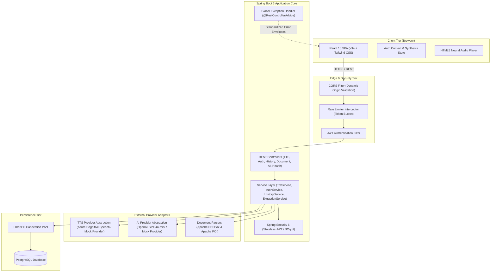
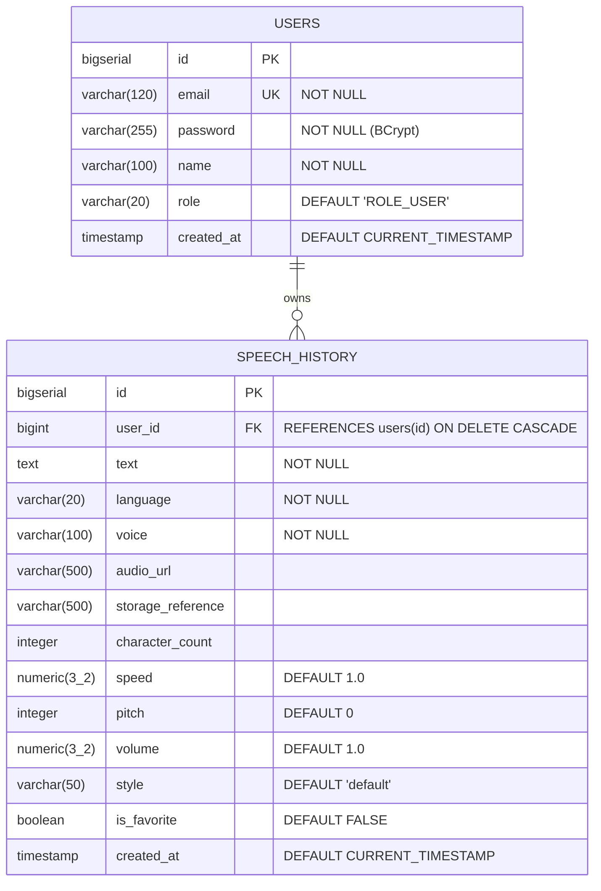

# VoxFlow Audio Studio — Production Text-to-Speech Platform

[](https://spring.io/projects/spring-boot)
[](https://react.dev/)
[](https://vitejs.dev/)
[](https://www.postgresql.org/)
[](LICENSE)
[](TESTING.md)

---

## 1. Project Title
**VoxFlow Audio Studio** — Enterprise-Grade Neural Text-to-Speech & Document Synthesis Platform.

---

## 2. Project Overview
**VoxFlow Audio Studio** is a full-stack, enterprise-grade web application that converts textual content and uploaded documents (TXT, PDF, DOCX) into natural speech using neural speech synthesis engines. The system integrates advanced audio customizations (speed, pitch, volume, style), optional AI text enhancement (summarization, grammar correction, conversational rephrasing), user authentication, audit history management, and token-bucket rate limiting.

Built with a **Spring Boot 3 (Java 17+)** backend, a **React 18 (Vite + Tailwind CSS)** frontend, and a **PostgreSQL** persistence store, the platform follows clean architecture principles, strict layer separation, centralized error handling, and zero-secret production configuration.

---

## 3. Problem Statement
Traditional text-to-speech tools often suffer from key limitations:
- **Monotonous Audio**: Lack of nuanced intonation, speed, pitch, and voice style controls.
- **Fragmented Workflows**: Inability to directly upload formatted business documents (PDFs, Word documents) without manually copying, pasting, and reformatting text.
- **Raw Input Issues**: Poorly structured, unpunctuated, or overly verbose text yields robotic, disjointed audio.
- **Security & Privacy Gaps**: Cloud TTS API keys and AI credentials are frequently exposed to client-side code, while unauthenticated endpoints invite automated bot abuse and volumetric DDoS attacks.
- **Ephemeral Sessions**: Absence of persistent history, tagging, favorites, and auditable synthesis logs.

---

## 4. Objectives
- **High-Fidelity Audio Generation**: Deliver near-instantaneous streaming audio synthesis with support for multiple languages, accents, and emotional voice styles.
- **Document-to-Speech Workflow**: Safely parse, extract, and clean paragraphs from TXT, PDF, and DOCX documents with automated security validation (size caps, MIME verification, encryption checks).
- **AI-Powered Preprocessing**: Provide optional server-side LLM enhancement to summarize lengthy text, correct grammar, and adjust tone before generating audio.
- **Enterprise Security**: Implement stateless JWT authentication, BCrypt password hashing, token-bucket rate limiting, and zero client-exposed secrets.
- **Comprehensive Observability & Resilience**: Provide automated multi-tier testing (100% test coverage across 132 automated tests), granular health telemetry, and multi-profile production readiness.

---

## 5. Features

### 5.1 Implemented Features (Current Release)
- **Neural Speech Synthesis**:
  - Multi-language catalog (English, Spanish, French, German, Japanese, and more).
  - Neural voice selector with gender and regional accent filtering.
  - Streaming binary MP3 output with dynamic audio metadata headers (`X-Voice-Id`, `X-Audio-Duration`, `Content-Disposition`).
- **Granular Speech Settings**:
  - Configurable playback speed ($0.5\times$ to $2.0\times$).
  - Pitch adjustment ($-10\text{ semitones}$ to $+10\text{ semitones}$).
  - Volume attenuation ($0\%$ to $100\%$).
  - Expressive voice styles (default, cheerful, empathetic, newscast, customer service) with automatic fallback for unsupported voices.
- **Document Text Extraction**:
  - Direct file upload supporting `.txt` (UTF-8/ASCII auto-detection), `.pdf` (Apache PDFBox text stripper), and `.docx` (Apache POI XML paragraph extractor).
  - Strict security validation: MIME validation, extension check, 10MB payload limit, encrypted/password-protected file rejection.
  - Direct extraction into the editor for human review prior to synthesis.
- **AI-Assisted Text Enhancement**:
  - Server-side LLM preprocessing: `SUMMARIZE`, `CORRECT_GRAMMAR`, `REWRITE`, `CONVERSATIONAL`.
  - Preview before apply: user reviews original vs enhanced text side-by-side before replacement.
  - Complete backend provider abstraction (`MockAiProvider` for offline development, `ExternalAiProviderImpl` for cloud LLM APIs).
- **Custom Audio Player & Exporter**:
  - Interactive scrubber, duration tracking, buffering/ready indicators, volume/mute toggles, and variable playback speeds ($1\times$, $1.25\times$, $1.5\times$, $2\times$).
  - One-click MP3 download with sanitized, descriptive filenames (`speech-[voice]-[id].mp3`).
- **User Authentication & Authorization**:
  - Secure registration and login with BCrypt password hashing ($10\text{ rounds}$).
  - Stateless JWT token lifecycle with automatic expiration and bearer authentication.
  - Protected API routes and route guards.
- **Speech History & Auditing**:
  - Persistent database logging of user synthesis requests.
  - Full-text search and language/voice filtering.
  - Favorite toggling and single-click replay/download.
  - Strict row-level ownership enforcement (users can only view or delete their own records).
- **Production Hardening & Abuse Prevention**:
  - Token-bucket rate limiting ($30\text{ req/min}$, burst capacity of $10$) on `/api/tts`, `/api/ai/**`, and `/api/documents/**`.
  - Proxy-aware IP extraction (`X-Forwarded-For`, `X-Real-IP`).
  - Standardized JSON error response envelope (`API_ERROR` structure) without stack trace leakage.
  - Dual configuration profiles (`dev` and `prod`) with zero committed secrets.

### 5.2 Future Enhancements (Roadmap)
- [ ] **SSML Visual Editor**: Interactive timeline editor for `<break>`, `<emphasis>`, `<prosody>`, and `<phoneme>` tags.
- [ ] **Multi-Speaker Dialogues**: Script-style alternating voices within a single synthesis track.
- [ ] **Custom Voice Cloning**: Few-shot acoustic model fine-tuning from user audio samples.
- [ ] **Speech-to-Text (STT) Transcription**: Bidirectional audio-to-text transcription engine.
- [ ] **Asynchronous Webhooks & Cloud Storage**: Direct S3/GCS bucket offloading for long-form audiobook batch processing.

---

## 6. Architecture

VoxFlow adheres to a **Clean Layered Architecture** separating presentation, business logic, security interceptors, data persistence, and external provider integration.

### System Architecture Diagram


---

## 7. Technology Stack

### Backend
| Technology | Version | Purpose |
| :--- | :--- | :--- |
| **Java** | 17+ (JDK 22 compatible) | Core programming language |
| **Spring Boot** | 3.3.4 | Application framework |
| **Spring Security** | 6.3.3 | Authentication & authorization |
| **Spring Data JPA** | 3.3.4 | Object-relational mapping (Hibernate 6.5) |
| **JJWT** | 0.12.6 | JSON Web Token issuance and parsing |
| **Apache PDFBox** | 3.0.3 | PDF text extraction |
| **Apache POI** | 5.3.0 | DOCX paragraph and document extraction |
| **PostgreSQL Driver** | 42.7.4 | Database connectivity |
| **HikariCP** | 5.1.0 | High-performance connection pooling |
| **Lombok** | 1.18.34 | Boilerplate elimination |

### Frontend
| Technology | Version | Purpose |
| :--- | :--- | :--- |
| **React** | 18.3.1 | Component-based user interface |
| **Vite** | 5.4.6 | Fast build tool and module bundler |
| **Tailwind CSS** | 3.4.11 | Utility-first responsive styling |
| **React Router** | 6.26.2 | Client-side routing and protected routes |
| **Axios** | 1.7.7 | HTTP client with request/response interceptors |
| **Lucide React** | 0.441.0 | Accessible icon system |

### Testing & Verification
| Technology | Purpose |
| :--- | :--- |
| **Spring Boot Test / MockMvc** | Serverless backend HTTP endpoint and controller testing |
| **JUnit 5 & Mockito** | Backend unit and mock testing |
| **H2 Database** | In-memory database for isolated test execution |
| **Vitest 2.1** | Lightning-fast frontend unit and integration test runner |
| **React Testing Library** | Component behavioral testing and accessibility verification |
| **JSDOM 30.1** | Headless browser DOM simulation |
| **Postman** | Comprehensive API test suite and automated environment capture |

---

## 8. Project Structure

```text
text-to-speech/
├── .env.example                     # Unified environment template
├── .gitignore                       # Root git exclusion rules (secrets, build files)
├── README.md                        # Project documentation (this file)
├── TESTING.md                       # Comprehensive testing guide & results
├── postman/
│   └── VoxFlow_TTS_API_Collection.json # Postman API collection (10 endpoints)
├── backend/
│   ├── pom.xml                      # Maven dependencies & build plugins
│   ├── .env.example                 # Backend environment variable template
│   ├── .gitignore                   # Backend exclusion rules
│   └── src/
│       ├── main/
│       │   ├── java/com/example/tts/
│       │   │   ├── config/          # CORS, WebMVC, Properties, Security configs
│       │   │   ├── controller/      # REST API controllers (TTS, Auth, History, Document, AI, Health, Voice)
│       │   │   ├── dto/             # Request & Response DTO records
│       │   │   ├── exception/       # Custom exceptions & centralized @RestControllerAdvice
│       │   │   ├── mapper/          # DTO <-> Entity mappers
│       │   │   ├── model/           # JPA entities (User, SpeechHistory) & enums
│       │   │   ├── repository/      # Spring Data JPA repositories
│       │   │   ├── security/        # JWT filter, EntryPoint, UserPrincipal, RateLimiter
│       │   │   ├── service/         # Service interfaces
│       │   │   │   ├── impl/        # Service business logic implementations
│       │   │   │   └── provider/    # Speech & AI provider abstractions (Azure, OpenAI, Mock)
│       │   │   └── TtsApplication.java # Spring Boot main entrypoint
│       │   └── resources/
│       │       ├── application.yml      # Base common configuration (default profile: dev)
│       │       ├── application-dev.yml  # Development profile configuration
│       │       ├── application-prod.yml # Production profile configuration (zero secrets)
│       │       └── schema.sql           # PostgreSQL database schema & indexes
│       └── test/
│           ├── java/com/example/tts/    # 109 automated unit, integration & security tests
│           └── resources/
│               └── application.yml      # Isolated test configuration (H2 in-memory)
└── frontend/
    ├── package.json                 # Node dependencies and scripts
    ├── vite.config.js               # Vite build configuration (chunks, minification, sourcemaps)
    ├── tailwind.config.js           # Tailwind theme tokens
    ├── postcss.config.js            # PostCSS configuration
    ├── .env.example                 # Frontend environment template
    ├── .gitignore                   # Frontend exclusion rules
    └── src/
        ├── components/              # UI components (TextInput, Selectors, AudioPlayer, DocumentUploader, AIEnhance)
        ├── context/                 # AuthContext & global state providers
        ├── hooks/                   # Custom hooks (useHealthCheck)
        ├── layouts/                 # Page wrappers (MainLayout, Header, Footer)
        ├── pages/                   # Application routes (HomePage, HistoryPage, LoginPage, RegisterPage)
        ├── services/                # Axios API services (api.js, authService.js, ttsService.js, historyService.js)
        ├── test/                    # 23 automated Vitest & RTL component tests
        └── utils/                   # Constants, formatters, voice data
```

---

## 9. Database Design

VoxFlow uses a normalized PostgreSQL schema designed for high-concurrency read queries, auditable history tracking, and cascading deletion.

### Entity Relationship Diagram


### Table Definitions & Indexes
1. **`users` Table**:
   - `id` (BIGSERIAL, Primary Key)
   - `email` (VARCHAR(120), Unique, Not Null)
   - `password` (VARCHAR(255), Not Null, BCrypt hash)
   - `name` (VARCHAR(100), Not Null)
   - `role` (VARCHAR(20), Default `'ROLE_USER'`)
   - `created_at` (TIMESTAMP, Default `CURRENT_TIMESTAMP`)
   - *Index*: `idx_users_email` on `users(email)`.

2. **`speech_history` Table**:
   - `id` (BIGSERIAL, Primary Key)
   - `user_id` (BIGINT, Foreign Key referencing `users(id)` ON DELETE CASCADE)
   - `text` (TEXT, Not Null)
   - `language` (VARCHAR(20), Not Null)
   - `voice` (VARCHAR(100), Not Null)
   - `audio_url` (VARCHAR(500))
   - `storage_reference` (VARCHAR(500))
   - `character_count` (INTEGER)
   - `speed` (NUMERIC(3,2), Default `1.0`)
   - `pitch` (INTEGER, Default `0`)
   - `volume` (NUMERIC(3,2), Default `1.0`)
   - `style` (VARCHAR(50), Default `'default'`)
   - `is_favorite` (BOOLEAN, Default `FALSE`)
   - `created_at` (TIMESTAMP, Default `CURRENT_TIMESTAMP`)
   - *Indexes*:
     - `idx_speech_history_created_at` on `(created_at DESC)`
     - `idx_speech_history_lang_voice` on `(language, voice)`
     - `idx_speech_history_user_id` on `(user_id)`

---

## 10. API Documentation

All API endpoints are prefixed with `/api`. Responses adhere to a standardized response structure.

### 10.1 Standard Error Envelope
When any API call encounters an error, the backend returns:
```json
{
  "success": false,
  "error": {
    "code": "INVALID_REQUEST",
    "message": "Text cannot exceed 5000 characters",
    "details": {
      "text": "Text cannot exceed 5000 characters"
    }
  },
  "timestamp": "2026-09-27T16:00:00Z"
}
```

---

### 10.2 System & Voice Endpoints

#### `GET /api/health`
- **Description**: Lightweight health probe for load balancers and container orchestrators.
- **Access**: Public
- **Response `200 OK`**:
  ```json
  {
    "status": "UP",
    "message": "Text-to-Speech backend is running",
    "environment": "prod",
    "timestamp": "2026-09-27T16:00:00Z"
  }
  ```

#### `GET /api/voices`
- **Description**: Returns the active catalog of neural voices.
- **Access**: Public
- **Query Parameters**:
  - `language` *(optional)*: Filter by BCP-47 language tag (e.g. `en-US`, `es-ES`).
- **Response `200 OK`**:
  ```json
  [
    {
      "id": "en-US-JennyNeural",
      "name": "Jenny",
      "language": "en-US",
      "gender": "Female",
      "supportedStyles": ["default", "cheerful", "empathetic"]
    }
  ]
  ```

---

### 10.3 Speech Synthesis Endpoints

#### `POST /api/tts`
- **Description**: Synthesizes input text to binary audio stream (`audio/mpeg`).
- **Access**: Authenticated (Bearer Token optional for guest generation)
- **Headers**:
  - `Content-Type: application/json`
  - `Authorization: Bearer <jwt_token>` *(optional)*
- **Request Body**:
  ```json
  {
    "text": "Welcome to VoxFlow studio. Your high-fidelity neural speech synthesis platform.",
    "language": "en-US",
    "voice": "en-US-JennyNeural",
    "speed": 1.0,
    "pitch": 0,
    "volume": 1.0,
    "style": "default"
  }
  ```
- **Response `200 OK`**:
  - Content: Binary MP3 audio stream (`audio/mpeg`)
  - Custom Headers:
    - `Content-Disposition: inline; filename="speech-en-US-JennyNeural.mp3"`
    - `X-Voice-Id: en-US-JennyNeural`
    - `X-Language: en-US`
    - `X-Audio-Format: audio/mpeg`
    - `X-Character-Count: 78`
- **Possible Errors**:
  - `400 Bad Request`: `INVALID_REQUEST` (empty or excessive text $>5000$ chars), `INVALID_LANGUAGE`, `INVALID_VOICE`.
  - `401 Unauthorized`: Token missing or invalid when route authentication is enforced.
  - `429 Too Many Requests`: `TOO_MANY_REQUESTS` (rate limit exceeded, includes `Retry-After` header).
  - `502 Bad Gateway`: `SYNTHESIS_FAILED` (speech provider failed).
  - `503 Service Unavailable`: `SERVICE_UNAVAILABLE` (cloud provider timeout or downtime).

---

### 10.4 Authentication Endpoints

#### `POST /api/auth/register`
- **Description**: Creates a new user account.
- **Access**: Public
- **Request Body**:
  ```json
  {
    "username": "demouser",
    "email": "demo@example.com",
    "password": "Password123!"
  }
  ```
- **Response `201 Created`**:
  ```json
  {
    "token": "eyJhbGciOiJIUzI1NiJ9...",
    "type": "Bearer",
    "user": {
      "id": 1,
      "username": "demouser",
      "email": "demo@example.com",
      "role": "ROLE_USER"
    }
  }
  ```
- **Possible Errors**:
  - `400 Bad Request`: `VALIDATION_FAILED` (invalid email syntax, password $<6$ characters).
  - `409 Conflict`: `USER_ALREADY_EXISTS` (email already registered).

#### `POST /api/auth/login`
- **Description**: Authenticates user credentials and issues a signed JWT token.
- **Access**: Public
- **Request Body**:
  ```json
  {
    "username": "demo@example.com",
    "password": "Password123!"
  }
  ```
- **Response `200 OK`**:
  ```json
  {
    "token": "eyJhbGciOiJIUzI1NiJ9...",
    "type": "Bearer",
    "user": {
      "id": 1,
      "username": "demouser",
      "email": "demo@example.com",
      "role": "ROLE_USER"
    }
  }
  ```
- **Possible Errors**:
  - `401 Unauthorized`: `INVALID_CREDENTIALS` (incorrect email or password).

---

### 10.5 Speech History Endpoints

#### `GET /api/history`
- **Description**: Retrieves paginated synthesis history for the authenticated user.
- **Access**: Authenticated (`Bearer <token>`)
- **Query Parameters**:
  - `page`: Page index (default `0`).
  - `size`: Page batch size (default `10`).
  - `sort`: Sort property and direction (default `createdAt,desc`).
- **Response `200 OK`**:
  ```json
  [
    {
      "id": 101,
      "text": "Welcome to VoxFlow studio.",
      "language": "en-US",
      "voice": "en-US-JennyNeural",
      "characterCount": 26,
      "speed": 1.0,
      "pitch": 0,
      "volume": 1.0,
      "style": "default",
      "favorite": false,
      "createdAt": "2026-09-27T15:30:00"
    }
  ]
  ```
- **Possible Errors**:
  - `401 Unauthorized`: Unauthenticated request.

#### `GET /api/history/{id}`
- **Description**: Fetches single history record. Validates that the record belongs to the requesting user.
- **Access**: Authenticated (`Bearer <token>`)
- **Response `200 OK`**: Speech history item object.
- **Possible Errors**:
  - `403 Forbidden`: `FORBIDDEN` (attempting to view another user's history).
  - `404 Not Found`: `NOT_FOUND` (record does not exist).

#### `DELETE /api/history/{id}`
- **Description**: Deletes a single history record owned by the authenticated user.
- **Access**: Authenticated (`Bearer <token>`)
- **Response `200 OK`**:
  ```json
  {
    "success": true,
    "message": "Speech history record 101 deleted successfully"
  }
  ```
- **Possible Errors**:
  - `403 Forbidden`: Record owned by another user.
  - `404 Not Found`: Record not found.

#### `PATCH /api/history/{id}/favorite`
- **Description**: Toggles favorite status for a history record.
- **Access**: Authenticated (`Bearer <token>`)
- **Response `200 OK`**: Updated speech history item object.

---

### 10.6 Document & AI Processing Endpoints

#### `POST /api/documents/extract-text`
- **Description**: Extracts clean text from uploaded files (`.txt`, `.pdf`, `.docx`).
- **Access**: Public / Authenticated
- **Payload**: `multipart/form-data` with parameter `file`.
- **Response `200 OK`**:
  ```json
  {
    "success": true,
    "filename": "quarterly-report.pdf",
    "fileType": "pdf",
    "characterCount": 1420,
    "extractedText": "Quarterly Performance Summary..."
  }
  ```
- **Possible Errors**:
  - `400 Bad Request`: Unsupported file type, corrupted file, or encrypted/password-protected PDF.
  - `413 Payload Too Large`: File exceeds 10MB limit.

#### `POST /api/ai/enhance`
- **Description**: Processes text using specified AI transformation operation.
- **Access**: Public / Authenticated
- **Request Body**:
  ```json
  {
    "text": "we has completed the feature testing and it work very good now.",
    "operation": "CORRECT_GRAMMAR"
  }
  ```
  *(Supported operations: `SUMMARIZE`, `CORRECT_GRAMMAR`, `REWRITE`, `CONVERSATIONAL`)*
- **Response `200 OK`**:
  ```json
  {
    "success": true,
    "originalText": "we has completed the feature testing and it work very good now.",
    "enhancedText": "We have completed the feature testing, and it works very well now.",
    "operation": "CORRECT_GRAMMAR"
  }
  ```
- **Possible Errors**:
  - `400 Bad Request`: Missing text or unsupported operation.
  - `429 Too Many Requests`: AI rate limit exceeded.
  - `503 Service Unavailable`: AI provider timeout or service failure.

---

## 11. Environment Variables

### Backend Configuration Variables

| Variable | Description | Development Default | Production Required |
| :--- | :--- | :--- | :---: |
| `SPRING_PROFILES_ACTIVE` | Active Spring profile (`dev` or `prod`) | `dev` | **Yes** (`prod`) |
| `SERVER_PORT` / `PORT` | Web server port | `8080` | Optional |
| `DB_URL` | PostgreSQL JDBC connection URL | `jdbc:postgresql://localhost:5432/tts_db` | **Yes** |
| `DB_USERNAME` | PostgreSQL database user | `postgres` | **Yes** |
| `DB_PASSWORD` | PostgreSQL database password | `postgres` | **Yes** |
| `DB_POOL_MAX` | HikariCP max connection pool size | `10` | Optional (`20`) |
| `DB_CONNECT_TIMEOUT_MS` | Database connection timeout (ms) | `5000` | Optional (`30000`) |
| `CORS_ALLOWED_ORIGINS` | Comma-separated frontend origins | `http://localhost:5173` | **Yes** |
| `JWT_SECRET` | 256-bit secret key for HMAC-SHA256 signing | *Development test key* | **Yes** |
| `JWT_EXPIRATION_MS` | JWT token validity in milliseconds | `86400000` (24h) | Optional |
| `RATE_LIMIT_ENABLED` | Enable token-bucket rate limiter | `true` | Optional |
| `RATE_LIMIT_RPM` | Max requests per minute per IP | `60` | Optional (`30`) |
| `RATE_LIMIT_BURST` | Token bucket burst capacity | `20` | Optional (`10`) |
| `TTS_PROVIDER` | TTS Provider (`MOCK` or `AZURE`) | `MOCK` | Optional (`AZURE`) |
| `TTS_API_KEY` | Azure Cognitive Services Speech API Key | `""` | **Yes** (if Azure) |
| `TTS_REGION` | Azure Cognitive Speech Region | `eastus` | Optional |
| `TTS_ENDPOINT` | Azure Cognitive Speech Endpoint | `""` | Optional |
| `TTS_CONNECT_TIMEOUT_MS`| Timeout connecting to TTS provider (ms) | `5000` | Optional |
| `TTS_READ_TIMEOUT_MS` | Timeout receiving TTS audio data (ms) | `10000` | Optional |
| `AI_PROVIDER` | AI Provider (`MOCK` or `OPENAI`) | `MOCK` | Optional (`OPENAI`)|
| `AI_API_KEY` | OpenAI / LLM API Key | `""` | **Yes** (if OpenAI) |
| `AI_ENDPOINT` | Chat completion endpoint URL | `https://api.openai.com/v1/chat/completions` | Optional |
| `AI_MODEL` | AI model identifier | `gpt-4o-mini` | Optional |

### Frontend Configuration Variables

| Variable | Description | Default |
| :--- | :--- | :--- |
| `VITE_API_BASE_URL` | Base URL of the backend API gateway | `http://localhost:8080` |

## 12. Local Setup Guide

### Prerequisites
- **JDK 17+** (Recommended: Java 21 or 22)
- **Node.js 18+** & **npm 9+**
- **PostgreSQL 14+** *(Optional for local demo testing)*
- **Git**

### 12.1 Predefined Demo Account (Local Testing without PostgreSQL)

For immediate local development and demonstration testing without needing a running PostgreSQL instance, a predefined test account is enabled in the development profile:

| Field | Demo Credential |
| :--- | :--- |
| **Email** | `demo@textspeech.local` |
| **Password** | `Demo@12345` |
| **Display Name** | `Demo User` |
| **Role** | `ROLE_USER` |

> [!NOTE]
> **Demo Account Behavior & Architecture:**
> - **Zero Database Dependency**: When PostgreSQL is offline, the backend's development authentication fallback verifies credentials via BCrypt against a configured password hash and generates an authentic HMAC-SHA256 JWT token.
> - **In-Memory Speech History**: During local sessions without PostgreSQL, speech history for the demo account is managed in-memory with pre-loaded demo records and resets on server restart.
> - **PostgreSQL for Persistent Accounts**: PostgreSQL is required for permanent user registration and persistent cross-session history storage. If PostgreSQL is running, the demo account is automatically seeded into the database.
> - **Production Isolation**: Demo authentication is strictly disabled in production (`app.demo-auth.enabled=false` in `application-prod.yml`). Plaintext passwords are never stored in source code, logs, API responses, or production configurations.

---

## 13. Frontend Setup

1. **Navigate to the frontend directory**:
   ```bash
   cd frontend
   ```
2. **Install dependencies**:
   ```bash
   npm install --legacy-peer-deps
   ```
3. **Configure environment**:
   ```bash
   cp .env.example .env
   ```
4. **Start development server**:
   ```bash
   npm run dev
   ```
   The frontend will be available at `http://localhost:5173`.
5. **Run test suite**:
   ```bash
   npm test
   ```
6. **Build for production**:
   ```bash
   npm run build
   ```

---

## 14. Backend Setup

1. **Navigate to the backend directory**:
   ```bash
   cd backend
   ```
2. **Configure environment**:
   ```bash
   cp .env.example .env
   ```
3. **Build the application**:
   ```bash
   ./mvnw clean package -DskipTests
   ```
4. **Run the backend in development mode**:
   ```bash
   ./mvnw spring-boot:run
   ```
   The backend API will start on `http://localhost:8080` with the `dev` profile active.
5. **Run all backend tests**:
   ```bash
   ./mvnw test
   ```

---

## 15. PostgreSQL Setup

1. **Access PostgreSQL CLI**:
   ```bash
   psql -U postgres
   ```
2. **Create database**:
   ```sql
   CREATE DATABASE tts_db;
   ```
3. **Create dedicated user and grant permissions**:
   ```sql
   CREATE USER tts_user WITH ENCRYPTED PASSWORD 'your_secure_password';
   GRANT ALL PRIVILEGES ON DATABASE tts_db TO tts_user;
   \c tts_db
   GRANT ALL ON SCHEMA public TO tts_user;
   ```
4. **Apply schema**:
   The database schema is automatically validated/applied from [schema.sql](file:///c:/Users/ronak/Desktop/TextSpeech%20Application/text-to-speech/backend/src/main/resources/schema.sql) on application startup.

---

## 16. TTS Provider Configuration

VoxFlow includes a pluggable provider architecture with zero code coupling to cloud SDKs.

### 16.1 Local Development (`MOCK` Mode)
In development, `TTS_PROVIDER=MOCK` produces synthetic MP3-compliant audio streams locally without requiring cloud accounts, credit cards, or external API keys.

### 16.2 Production Azure Cognitive Speech Configuration
To enable Microsoft Azure Neural Text-to-Speech in production:
1. Create a Speech resource in the [Azure Portal](https://portal.azure.com/).
2. Retrieve your **Key 1** and **Location/Region** (e.g. `eastus`).
3. Set the following environment variables:
   ```env
   TTS_PROVIDER=AZURE
   TTS_API_KEY=your_azure_speech_key_here
   TTS_REGION=eastus
   TTS_ENDPOINT=https://eastus.tts.speech.microsoft.com/cognitiveservices/v1
   ```

---

## 17. Authentication Architecture

VoxFlow implements a **Stateless JWT Security Architecture**:
1. **Password Security**: Passwords are encrypted using BCrypt with a cost factor of $10$ prior to persistence. Plaintext passwords are never logged or stored.
2. **Token Issuance**: Upon successful credential validation (`POST /api/auth/login`), the backend signs an HMAC-SHA256 JWT payload containing user ID, email, roles, and a 24-hour expiration timestamp.
3. **Filter Chain**: Every incoming HTTP request passes through [JwtAuthenticationFilter.java](file:///c:/Users/ronak/Desktop/TextSpeech%20Application/text-to-speech/backend/src/main/java/com/example/tts/security/JwtAuthenticationFilter.java). The token is verified against `JWT_SECRET`, extracting user claims into the Spring Security Context.
4. **Row-Level Authorization**: Data mutations in [SpeechHistoryServiceImpl.java](file:///c:/Users/ronak/Desktop/TextSpeech%20Application/text-to-speech/backend/src/main/java/com/example/tts/service/impl/SpeechHistoryServiceImpl.java) verify ownership (`record.userId == authenticatedUser.id`), returning HTTP 403 Forbidden for unauthorized requests.

---

## 18. Testing

VoxFlow features a dual-stack test suite comprising **141 automated tests** across both backend and frontend layers.

| Layer | Engine | Tests Passed | Command |
| :--- | :--- | :---: | :--- |
| **Backend** | Spring Boot Test, MockMvc, JUnit 5, Mockito | **118 / 118** | `cd backend && ./mvnw test` |
| **Frontend** | Vitest 2.1, React Testing Library, JSDOM | **23 / 23** | `cd frontend && npm test` |
| **Total** | | **141 / 141 (100%)** | |

Detailed test descriptions, security verification tests, and error matrix mapping are documented in [TESTING.md](file:///c:/Users/ronak/Desktop/TextSpeech%20Application/text-to-speech/TESTING.md).

---

## 19. Postman Collection

A complete, self-contained Postman collection is located at:
📁 **[`postman/VoxFlow_TTS_API_Collection.json`](file:///c:/Users/ronak/Desktop/TextSpeech%20Application/text-to-speech/postman/VoxFlow_TTS_API_Collection.json)**

### Features:
- Maps all **10 primary REST endpoints**.
- Pre-configured with parameterized environment variables (`{{baseUrl}}`, `{{authToken}}`).
- Includes an automatic token-capture test script on `POST /api/auth/login` that updates `{{authToken}}` for subsequent requests.
- Contains **zero real credentials or secrets**.

---

## 20. Deployment Guide

### 20.1 Production Docker Compose Deployment
Create a `docker-compose.yml` file in the project root:

```yaml
version: '3.8'

services:
  postgres:
    image: postgres:15-alpine
    container_name: voxflow-postgres
    restart: always
    environment:
      POSTGRES_DB: tts_db
      POSTGRES_USER: postgres
      POSTGRES_PASSWORD: ${DB_PASSWORD}
    volumes:
      - pgdata:/var/lib/postgresql/data
    ports:
      - "5432:5432"

  backend:
    build:
      context: ./backend
      dockerfile: Dockerfile
    container_name: voxflow-backend
    restart: always
    depends_on:
      - postgres
    environment:
      SPRING_PROFILES_ACTIVE: prod
      DB_URL: jdbc:postgresql://postgres:5432/tts_db
      DB_USERNAME: postgres
      DB_PASSWORD: ${DB_PASSWORD}
      JWT_SECRET: ${JWT_SECRET}
      CORS_ALLOWED_ORIGINS: ${CORS_ALLOWED_ORIGINS}
      TTS_PROVIDER: ${TTS_PROVIDER}
      TTS_API_KEY: ${TTS_API_KEY}
    ports:
      - "8080:8080"

  frontend:
    build:
      context: ./frontend
      dockerfile: Dockerfile
    container_name: voxflow-frontend
    restart: always
    ports:
      - "80:80"

volumes:
  pgdata:
```

---

## 21. Security Considerations

- **Zero Committed Secrets Policy**: All production configs require credentials from the host environment. Git ignore rules strictly prevent committing `.env` files, keys, and certificates.
- **Token-Bucket Rate Limiter**: Configured at the web filter level to protect CPU/memory-intensive synthesis, document extraction, and AI operations against DDoS and API scraping.
- **Document Processing Hardening**:
  - File extension and MIME type cross-validation.
  - Maximum upload size capped at 10MB to prevent heap exhaustion.
  - Rejection of encrypted, password-protected, or malformed PDFs before parsing.
  - Clean in-memory processing without writing unvalidated files to the host filesystem.
- **XSS & Content Security**:
  - Security headers enforced: `X-Content-Type-Options: nosniff`, `X-Frame-Options: DENY`, `X-XSS-Protection: 1; mode=block`.
  - Frontend utilizes React JSX auto-escaping to eliminate reflected XSS risks.
- **CORS Protection**: Origin validation supports strict comma-delimited origin lists and dynamic wildcard patterns while preventing unauthorized cross-origin credential sharing.

---

## 22. Application Interface & Screenshots

### 1. Studio Dashboard
*The primary synthesis studio featuring rich dark mode, real-time character & word counters, neural voice selector, and speech customization sliders.*

### 2. Document-to-Speech Uploader
*Secure drag-and-drop document upload modal supporting PDF, DOCX, and TXT extraction with paragraph cleaning.*

### 3. AI Text Enhancement
*Side-by-side comparison modal allowing users to preview grammar corrections, summaries, or conversational rewrites before synthesis.*

### 4. Interactive Audio Player
*Custom HTML5 audio player with scrubber, playback rate switcher ($1\times$, $1.25\times$, $1.5\times$, $2\times$), volume controls, and instant MP3 download.*

### 5. Speech History Dashboard
*Audit log with full-text search, language/voice tag filters, favorite toggles, and single-click audio re-generation.*

---

## 23. Future Enhancements & Roadmap

The following capabilities are planned for future major releases:

| Feature | Target Version | Status | Description |
| :--- | :---: | :---: | :--- |
| **SSML Visual Builder** | v1.1.0 | Planned | Interactive GUI for pause, pitch, and prosody control tags. |
| **Multi-Speaker Dialogues**| v1.2.0 | Planned | Script editor supporting alternating character voices in one audio file. |
| **Few-Shot Voice Cloning** | v2.0.0 | Research | Custom voice profile creation from short recorded audio samples. |
| **Speech-to-Text (STT)** | v2.1.0 | Planned | Bidirectional audio transcription with speaker diarization. |
| **Direct S3/GCS Audio Offload** | v2.2.0 | Planned | Long-form audiobook processing with direct cloud storage upload. |

---

## 24. License

This project is licensed under the **MIT License** — see the [LICENSE](LICENSE) file for details.
